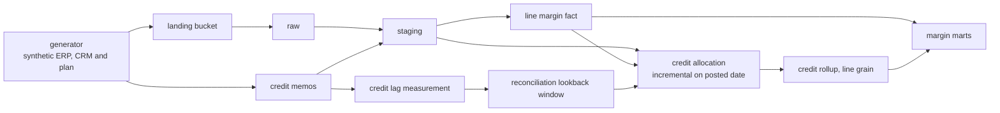

# gross-margin-bigquery

True gross margin by vendor, partner and product line, for a distributor whose
cost is not final when the invoice is. Vendor rebates and price protection credits
arrive weeks after the sale, so a margin number read at month close is wrong until
they land, and this repo is about knowing by how long and by how much.

```
python3 scripts/build_corpus.py
python3 scripts/run_transform.py
python3 scripts/lookback_probe.py
python3 scripts/allocation_fixture.py
```

The first generates the corpus, measures the credit lag and writes
`measurements/credit-lag.json`. The second loads that corpus into DuckDB, builds
the dbt models over it and writes `measurements/transform-shape.json`. The third
measures what a reconciliation lookback would miss under each of the two dates it
could be anchored on. The fourth runs the allocation models over a corpus small
enough to check by hand. Everything the first three write is re-derived by the
check suite, which needs no arguments and no data on disk.

```
python3 tests/run_all.py
```

## Shape



The generator is the only part that runs today. The bucket and the three datasets
are written as Terraform and have not been applied, and no BigQuery statement in
this repository has ever executed.

## The data is generated

Every figure below comes off a generator whose shape was chosen by hand. None of
it is a measurement of a real billing system. The lag distribution is lognormal
per credit kind because a settlement delay cannot go negative and has a long right
tail, and the medians are what the finance teams I have worked with described. That
is a design choice and not a finding.

What is not a design choice is the arrival calendar. Credits post on business days
and nothing posts during the close freeze, so the delay a vendor intends and the
delay a ledger sees are two different quantities. The generator draws the first and
throws the draw away. Only dates reach the output, which means the only lag anybody
can measure here is the one reconciliation will also have to work from.

## What the lag measurement says

The population is 3,591 credit memos over a two year window. 3,588 of those
credits still point at an invoice, and the three that do not are an injected
discrepancy rather than a bug. Rebuild every number here with
`python3 scripts/build_corpus.py`.

| quantity | days |
|---|---|
| observable lag, median | 18 |
| observable lag, ninety fifth centile | 105 |
| observable lag, largest seen | 164 |
| vendor raise lag, median | 17 |
| calendar hold, ninety fifth centile | 4 |

The calendar is worth a line of its own. 308 credits were held three days or more
past the date the vendor raised them, which is longer than a weekend and is the
close batch rather than the clock.

## One lookback window does not work, and it fails in both directions

A pooled window advertised at ninety five percent coverage delivers 82.23 percent
on volume rebates, because the pooled centile is pulled down by the two faster
kinds that hold most of the rows. It is simultaneously far too long for those two.
So the window is keyed by credit kind. `docs/lookback-window.md` carries the
per kind table and the argument.


## Injected discrepancies

The corpus is generated clean and the discrepancies are a separate pass over the
finished rows. A build with nothing requested reproduces the clean corpus byte for
byte, which is what makes it possible to attribute a moved figure to one change.
Each injector reports what it achieved rather than what it was asked for.

| discrepancy | rows | what a pipeline has to notice |
|---|---|---|
| orphan_credit | 9 | a credit quoting a line this system does not hold, and every third one loses its invoice too |
| duplicate_credit | 12 | one vendor document posted twice under two internal ids |
| cents_scaled_amount | 6 | an amount keyed in cents into a column holding dollars |
| overapplied_credit | 14 | a credit worth more than the line it adjusts, which drives cost negative |
| missing_partner | 31 | an invoice with no partner on it, which is the gap between billing and CRM |
| reassigned_product_line | 4 | a product moved to another product line partway through the window |

The last one is the only entry here that is not a bad row. Both product rows are
correct and the dimension is now effective dated, so margin by product line depends
on which row you join to and nothing in the data says that choice was made.

## The transformation layer

The models are written for BigQuery and verified against DuckDB on every run.
Nobody here holds a BigQuery project, so a layer that could only be exercised
against one would ship untested.

21 models and 80 data tests, all passing on
DuckDB. Seven staging views cast the landing text into exact decimals, and the
facts and marts sit above them. The scan pair exists to be queried rather than
read.

Three macros carry everything adapter specific. `money.sql` holds one money cast
and one date cast, because `numeric` is a BigQuery type name with no DuckDB alias
and `date_diff` takes its arguments in a different order on each engine.
`scan_layout.sql` returns a BigQuery partition and clustering spec or nothing,
chosen by adapter. `allocation.sql` holds the quarter truncation, the integer and
text type names, the lookback predicate and one cast described below. A check
refuses any of those spellings written into a model.

| table | rows |
|---|---|
| fct_invoice_line_margin | 20,446 |
| fct_credit_memo | 3,591 |
| fct_credit_allocation | 192,572 |
| credit_rollup_by_line | 20,446 |
| fct_gl_posting | 17,419 |
| recon_billing_to_gl | 98 |
| alert_late_credit_arrival | 1 |
| margin_by_vendor | 336 |
| margin_by_partner | 978 |
| margin_by_product_line | 144 |

Invoiced margin over the window is $75,517,103.43 and all
three marts agree with the line grain to the cent. That identity is a test rather
than a note, because three aggregations of one table are three chances to lose a
row.

Three results from building it, and the first is the one worth keeping.

93 invoice lines carry no partner at all, which is
the real gap between a billing system and a CRM. An inner join to the partner
dimension drops every one of them and takes $330,133.19
of margin out of the totals with nothing reporting a loss. They are kept with a
null key and a `has_partner` flag, and the partner mart gives them their own row.

A product can be moved to another product line partway through the window and
both rows are correct, so margin by product line depends on which version you
join to. `dim_product_version` closes each version with the start of the next and
the fact table resolves the one in force on the invoice date.
715 lines sit on a reassigned product.

9 credits name a line this system does not hold and
20 are worth more than the line they
adjust. Both keep their rows and get a flag.

## Credits do not belong to the line they arrive on

A price protection credit adjusts one line and a return credit adjusts one line.
A volume rebate does not. It is earned across a quarter of purchases and it
arrives quoting whichever line the billing system had to attach it to. Read as
one line's cost it makes that line look unprofitable and every other line in the
quarter look better than it was.

`fct_credit_allocation` gives every credit a scope and spreads it over the lines
in that scope, pro rata on the basis the credit adjusts. The scopes degrade in
one direction and nothing falls off the end.

| scope | credits | rows | what it means |
|---|---|---|---|
| direct | 2,650 | 2,650 | a line level credit on a line we hold |
| vendor_quarter | 932 | 189,899 | a rebate spread over the quarter it was earned in |
| invoice | 6 | 20 | the line is unknown and the invoice is not |
| unallocated | 3 | 3 | neither reference resolves |

Shares land on whole cents by largest remainder, with the line id breaking a tie
so the answer does not depend on row order. Every credit's parts sum back to the
credit exactly and a check refuses any that do not. A scope whose basis sums to
zero falls back to an equal split, because a rebate on a quarter of fully
discounted lines still has to go somewhere.

The marts publish three stages of one number. The margin the invoice claims, the
margin after each credit is applied to the line it names, and the margin after
allocation. Allocation moves money between vendors and periods without changing
the total, and it moved something in
294 of the 336
vendor periods. The largest single move is $73,708.33 off one vendor's
quarter, which is 28.0 percent of what that row claimed before
allocation.

The two totals differ by $5,448.99 over the whole
corpus, which is exactly the six credits allocation can place through their
invoice and the named reading cannot place at all. Neither total is the true
margin. The three credits nobody can place are in neither, and they are worth
$27,518.56.

### The spread is quadratic

932 rebates become 189,899 allocation rows and the table rebuilds inside the
normal `dbt build` with no cost worth noticing. That is the problem rather than
the reassurance, because the spread is a self join on the line table keyed by
vendor and quarter and 20,446 lines is small enough to hide a square.

| | lines | allocation rows | scoped join pairs |
|---|---|---|---|
| shipped | 20,446 | 192,572 | 189,899 |
| ten times | 205,713 | 18,266,702 | 18,240,971 |
| factor | 10.06 | 94.86 | 96.06 |

Ten times the lines is ninety six times the pairs. Grouping the lines to vendor
and quarter before the credit meets them is linear at 9.62, and that rewrite is
the fix and is not in this repository. `docs/allocation-fan-out.md` has the
argument, what the rewrite would and would not change, and the generator
assumption that had to be corrected to measure any of it.

## The lookback window

Both windows are set from a quantile of the measured arrival distribution
rather than from its maximum, because a maximum is the least stable order
statistic available and it moves 52 days across five seeds while the
centiles move 4 and 6. The window carries the body of the distribution with
its coverage stated and `alert_late_credit_arrival` carries the tail.
`docs/lookback-window.md` has the argument and `tests/test_recon.py` asserts
the derivation rather than the number.

## Billing against the general ledger, by period

`gl_entries.csv` is the second record of the same money. It is posted from
billing by `gross_margin/ledger.py` and then broken on purpose, which is stated
here rather than buried: the reconciliation recovers defects this repository
injected, so the count of breaks is a property of the request in that module. The
arithmetic and the period attribution are what is real.

One difference is not injected at all and it is the bulk of what a period
comparison shows. An invoice billed in the close freeze at the end of a month
posts to the ledger in the following month, because `gross_margin/calendar.py`
says accounts payable was shut. Nobody has lost anything and it clears by itself.

`recon_billing_to_gl` splits every period and account into the two terms, in
whole cents.

| term | what it means | who has to act |
|---|---|---|
| period shift | one document, two periods | nobody |
| break | unposted, orphaned, or keyed at a different amount | somebody |

Over this corpus the gross variance across 98 period and account rows is
$36,686,739.57. Of that, $36,551,436.86 is period shift and $630,907.71 is a
break, so 98.3 percent of the two gross terms is the shift and that much resolves
with nobody touching it. 58 rows carry a variance and 16 carry a break. The signed
period shift is $0.00 exactly, because moving a document between two periods
cannot create money, and a dbt test asserts that rather than trusting it.

That share replaced a wrong one on the completion pass. The figure published for
five days was the gross period shift over the gross variance, which is 99.63
percent and is not a share of anything, because `variance = period_shift + break`
holds per row with the terms free to disagree in sign. On this corpus 5 rows of
98 carry a shift larger than their own variance, so the ratio of the two absolute
column totals has no upper bound. It read as a share for as long as it happened
to stay under a hundred.

A loop found it rather than a review. The share is dominated by invoices billed
inside the close freeze and the width of that freeze is `FREEZE_BUSINESS_DAYS`,
which is 2 because the module author chose 2.

| close freeze, business days | share of the two terms | shift over variance | rows where the shift exceeds the variance |
|---|---|---|---|
| 1 | 97.34 | 99.12 | 4 |
| 2 | 98.3 | 99.63 | 5 |
| 3 | 98.82 | 100.77 | 6 |

At a three day close the old formula returns 100.77 percent, and a share above a
hundred percent is not a number with a rounding problem. Both figures are
published now, the bounded one as a share and the other named as a ratio.
`docs/period-shift-share.md` has the argument.


The break divides into $204,406.73 billing raised and the ledger never received,
$155,269.78 posted with no billing document behind it, and -$268,768.80 keyed at
a different amount.

That split is the point of the model. A period total says March is short. It does
not say whether March is short because an invoice is missing or because an
invoice was billed on the 31st, and those take very different amounts of
somebody's week.

### The alert

`alert_late_credit_arrival` holds every placeable credit that arrived later than
the reconciliation reopens. A row there means the period the credit adjusts was
closed before the credit existed, so that period's margin is stale and somebody
has to decide whether to restate it.

This corpus produces one. `CM0001949` is a volume rebate worth $1,931.69 that
arrived 164 days after its invoice, 14 days past the window, against a period of
2025-07 while the ledger posted it in 2025-12.

One row is the right size for this corpus and it is not evidence that the alert
is well tuned. The seed refit above says the arrival tail reaches at least 216
days, so a different draw of the same business puts more rows here.

## Proving it on numbers a person can check

Twenty thousand lines cannot be verified by reading them, so two six row corpora
carry every expected figure worked out on paper. `scripts/allocation_fixture.py`
covers all four allocation scopes, a rounding tie and a month boundary, then runs
the incremental three times to prove the anchor rather than the window.
`scripts/recon_fixture.py` does the same for the reconciliation and it exists
because of a defect it caught, where the full build passed 101 of 101 checks and
the six row fixture failed. `docs/hand-checked-fixtures.md` has both in full.


## Bytes scanned

No figure exists here. The quantity is a BigQuery one and a dry run needs
credentials this repository has no path to. So the clustered and unclustered
pair is a design with a harness behind it and no result.
`scripts/scan_probe.py` names the two identifiers it waits on and exits 2
rather than writing a figure. `docs/bytes-scanned.md` has the rest.

## The daily run, and the periods it reopens

`recon_reopen_days` was a number in `dbt_project.yml` and
`recon_billing_to_gl` published `inside_the_reopen_window` on every row.
Nothing read either one. The window was a word in this file and a column in
a table, and a reader who took it literally would have expected a process
that reopens periods. This is that process. It arrives with the scheduler
rather than before it, because a reprocessing job with nothing to run it is
the same overstatement one layer down.

`scripts/reopen_periods.py` reads the reconciliation, asks
`gross_margin/reopen.py` which periods can still move, recomputes those and
compares the answer against the rows the full build wrote for them. A period is
reopened when it is inside the window AND carries a term that is not settled.
Three terms qualify. An unposted document, a document the ledger will post
into another period, and an amount keyed wrong. The other two are far halves of
documents counted elsewhere, so a period holding only those moves when its
origin period does rather than on its own.

On this corpus 6 of 25 periods are inside the window and the term rule excludes
1 of those 6, so the scoped rerun touches 20 period and account rows against 98
for a full rebuild. **The window does nearly all of that work and the term rule
does very little**, which is worth saying plainly, because the rule is the part
with the argument behind it. What it buys at this size is that the job can say
which periods it recomputed and why, and the cost of being wrong about it grows
with the ledger rather than staying at one period.

The comparison is the reason to run it rather than to trust it. On a corpus with
no new data the scoped answer and the stored table have to agree cent for cent
across all seven compared columns, and they do, on 20 of 20 rows. A reprocessing
path that quietly answers differently from a full rebuild is how a close ends up
depending on which route ran last.

`orchestration/dags/gross_margin_daily.py` wires the five steps. It holds no
step list of its own. The graph is built by looping over
`gross_margin/pipeline.py`, which is also what
`tests/test_orchestration.py` reads, so a task added by hand beside the loop
fails the suite. The DAG was parsed with Airflow 2.11.2 under Python 3.11 and
`measurements/dag-parse.json` records the task ids, the dependencies and the
topological order it resolved. **A parse is not a run.** No scheduler has ever
been handed this file, and the measurement carries that as a field rather than
as a sentence so a check can assert it.

## Who can read what

Two rules, written once in `gross_margin/access.py` and enforced twice. Regional
roles read their own region. Roles that may not read cost cannot reach it by any
route these marts offer. `docs/access-model.md` carries the design, the measured
refusals and what is not covered.

Two things are worth pulling out of it.

Restricting the column named cost does not restrict cost. Margin is revenue minus
cost, so a reader holding revenue and margin holds cost, and the probe recovers it
on 20,446 of 20,446 rows to the cent from a variant that tagged only the cost
column. Margin is withheld for that reason, which means a regional role reads
revenue and not margin.

Region arrives by a left join to the partner, so lines billed with no partner
carry no region and no regional predicate matches them. 93 lines holding
2,024,816.82 of revenue are reachable by no regional role, and the four regional
reports therefore do not add up to the finance total.

### The grant was not implementing the refusal

`grants_for` refuses a regional role every mart with no region column. On DuckDB
that refusal is real because the role has no view. On BigQuery it was supposed to
come from the row access policy union, and the flaw is in the half of that rule
nobody read back. A table carrying no policy at all is filtered by nothing, and
`access.tf` holds one dataset grant that every role is on.

So the finance wide marts, which carried no policy because the rule list only
created them for tables with a region column, were readable in full by every
regional role.

| | regional role reads whole | narrowed by a policy | refused |
|---|---|---|---|
| before | 9 | 2 | 2 |
| after | 5 | 2 | 6 |

Every relation in the rule list now carries a policy and the union does the
refusing, which took the policy count from 14 to 22. Five marts are still open to
a regional role and they are the ones the access model never classified. They are
written down in `MARTS_OUTSIDE_THE_RULE_LIST` with a reason each and a check
refuses a mart in neither list, because absence from the rule list is a grant
rather than a default. `docs/access-model.md` has the rest.

## What a daily run costs

A list price multiplied out and not a measurement, and the difference is the
point. Nothing in `infra/` has been applied, so no bill exists.
`scripts/cost_model.py` reads the shape out of `infra/composer.tf`, reads the
rates out of `infra/price-list.json`, and multiplies.

The declared environment is the smallest Composer 2 shape that runs, 1.5 vCPU and
6 GiB across a scheduler, a web server and one worker. That comes to **10.75** a
day, $322.63 over 30 days, and the environment fee alone is 78.11 percent of it.

Every term in that total bills for existing rather than for work. So the number
does not move when the pipeline fires more often and it does not fall to zero on
a day it does not fire at all.

The term that would tell you what a run costs is missing. BigQuery on demand is
$6.25 per TiB with the first TiB free, and the quantity it multiplies has never
been measured, because a byte count needs a dry run and a dry run needs a billing
enabled project. The landing corpus is 2,957,980 bytes, which bounds storage
below the free tier without being the storage term.

That is an uncomfortable shape to publish and it is the honest one. The half that
bills for having a scheduler is priced. The half that does the work is not.
`docs/cost-and-teardown.md` carries the terms, the teardown procedure, and why
the documented one command destroy does not work.

## Infrastructure, written and not applied

`infra/` holds a landing bucket, three BigQuery datasets, a build identity and a
billing budget. It has never seen `terraform plan`, because that needs an OIDC
trust between this repository and a billing enabled project and creating that trust
is a one time step by somebody holding owner. The three identifying variables carry
no default, which is stated in `infra/variables.tf` along with what is missing.

`terraform validate` grades the schema and needs no credentials, and it passes. It
will not catch a configuration that is valid and wrong, so `tests/test_infra.py`
grades ten of those as text. A dataset whose contents a destroy may drop. A mart
with a table expiration on it. A bucket in one location and a dataset in another. A
build identity holding `dataOwner` rather than `dataEditor`. An identity pool that
trusts every repository on GitHub. A budget with no threshold above the budget.

## Known limitations

- No BigQuery statement here has run. The models compile for it and are
  verified against DuckDB, so the layer is exercised and the warehouse is not.
- The access rules are enforced locally by a view layer, and DuckDB has no role
  system, so there is no grant to make and nothing holds a caller to them. The
  rules are proven expressible and correct rather than proven binding.
- The same cost sits below the protected layer. `stg_invoice_lines` carries
  `extended_cost_usd` and `unit_cost_usd` with no tag on them, so the column
  control rests on the reporting roles holding the marts dataset alone.
- There is no bytes scanned figure, so the clustered and unclustered pair is a
  design with a test harness behind it and no result. `scripts/scan_probe.py`
  names what it waits on.
- There is no bytes per report session figure. Measuring one needs a Power BI
  workspace, a licence and a published semantic model. This repository has
  none of the three. An import model against DirectQuery is a comparison of
  two things that both have to exist, so unlike the Terraform there is no
  partial version to ship and no number here at all.
- Cloud Composer is declared in `infra/composer.tf` and has never been applied,
  like the rest of `infra/`. The daily figure in this file is a published price
  list multiplied out against a declared shape, so it is what the environment
  would be charged for existing and not what a run costs. The term that would
  answer that question is bytes scanned and it has no quantity.
- The reopen job recomputes and does not write back. A real deployment would
  materialise the scoped answer over the reopened partitions, and partition
  replacement on DuckDB is a different mechanism from the one BigQuery uses.
- DuckDB has neither partitioning nor clustering, so the two halves of the scan
  pair are identical tables there. The check that they hold the same rows is
  real. The layout difference is not, anywhere this has run.
- The analyses are compiled and never executed on BigQuery, so their SQL is
  graded by a parse and by the DuckDB build rather than by the engine the
  partition syntax is for.
- The tail of the lag distribution is a lower bound. 209 credits were scheduled to
  post after the window closes and were not written, so the corpus is right
  censored and the largest lag seen is the largest the window could hold.
- The lag medians are a design choice. They are stated here rather than buried,
  and no claim in this file depends on them being right about any real vendor.
- The windows carry no interval. Each one is a single centile of a single corpus at
  one seed, so the right reading of 20 against 49 is that they differ by a lot and
  not that either is accurate to the day.
- The business calendar holds US federal holidays for the generated window only. A
  wider window needs more rows in that list and nothing fails loudly if it misses.
- The suite builds its own corpus in memory. That is the clean clone case and it is
  not the same as a continuous integration job building from empty, which is the
  durable version and needs a workflow file this repo does not have.
- The allocated margin is a model of where a rebate was earned. It is not a
  recovery of something the data knows and hides. The generator attaches a rebate
  to one line because it has to attach it somewhere, so there is no hidden truth
  to score the spread against, and the fixture grades the arithmetic rather than
  the premise.
- Every vendor in the corpus raises rebates on the same cadence. The generator
  anchors a volume rebate on the quarter end and never reads the vendor's rebate
  program, so the three vendors on an annual program produce quarter anchored
  rebates anyway. Every window figure here is a property of that choice.
- The generator raises one rebate per selected line, so a vendor quarter carries
  several where a real vendor would raise one. The allocation is right about the
  rows it was given and the number of rows is not realistic.
- The rebate basis is extended cost, which assumes a rebate is earned in
  proportion to spend. A tiered rebate is not, and `plans.csv` carries a rate
  column nothing reads yet.
- The zero in the posted date column of the lookback table is zero by
  construction and not a result. Nothing in this corpus is posted out of arrival
  order.
- A line whose product version cannot be resolved has no vendor, so a rebate
  quoting it would fall through to `unallocated` rather than spreading. No line
  in this corpus is in that state, so the path is reasoned about and not
  exercised.
- The ledger is not an independent record. `gross_margin/ledger.py` posts it from
  billing and then breaks it, so the reconciliation recovers injected defects
  rather than defects that arose on their own. The count of breaks is a property
  of the request in that module. What is real is the arithmetic, the period
  attribution and the split.
- Four accounts stand in for a chart of accounts. A real distributor posts to
  hundreds, with mappings that are themselves a source of breaks, and none of
  that is modelled.
- `stg_gl_entries` flags an entry whose own period label disagrees with its
  posted date. No entry in this corpus does, because the generator writes the
  two together, so that flag is reasoned about and never true.
- The reopen job compares the scoped recomputation against the stored table on a
  corpus that did not change between them, so what it proves is that the two code
  paths agree. It does not prove the job would notice new data, because no second
  load has ever arrived.
- The alert holds one row. One row is the right size for this corpus and it is
  not evidence that the threshold is well chosen. The seed refit says the arrival
  tail reaches at least 216 days, so another draw of the same business puts more
  rows there.
- Five seeds is a spread and not a distribution. The refit reports the range over
  five draws and nothing here computes an interval from it, because an interval
  from five points would be a worse claim than the range.
- `fct_gl_posting` is a full outer join over 17,419 ledger entries and 17,415
  billing document rows, and nothing in the repo profiles it. At this size it
  does not matter. On a real ledger the join key and its selectivity are the
  thing to watch. The allocation self join beside it now has a growth figure and
  this one does not.
- Five marts are readable whole by a regional role on BigQuery, and they are the
  ones `gross_margin/access.py` never classified. They are written down in
  `MARTS_OUTSIDE_THE_RULE_LIST` with a reason each and a check refuses a mart in
  neither list. Three of them carry credit or ledger amounts at document grain,
  which is the same sensitivity recorded against `credit_rollup_by_line`, and
  that relation is refused. The consistent answer is probably to refuse these
  too. It changes what partner operations can report on as well, so it is a
  product decision rather than a correction.
- The reason recorded for withholding margin rather than revenue is weaker after
  today, not stronger. The argument was that revenue is obtainable by another
  route while margin exists nowhere outside these marts. The reachability read
  says that inside this warehouse a regional role now reaches revenue only for
  its own region, because the finance wide marts are refused and no role is
  granted staging or raw. So the other route is the billing system or the
  invoices the reader already holds, which is a claim about systems this
  repository cannot see and cannot check.
- The row access policy union is the mechanism the whole BigQuery side rests on
  and it has never been observed. Six of the 22 generated policies are explicit
  true predicates and they exist because a principal with no policy on a table
  that carries policies is believed to read zero rows. That is read off
  documentation and the provider schema. If it is wrong, those six are noise and
  the refusals built on absence do not refuse.
- The teardown procedure in `docs/cost-and-teardown.md` has never run.
  `terraform validate` grades a configuration and says nothing about whether a
  destroy succeeds, and the Composer environment carries `prevent_destroy`, so
  the documented single command stops on the most expensive resource.
- The freeze width sweep moves one constant and holds the seed. The share lands
  between 97.34 and 98.82 over three widths at one seed, so that range is the
  sensitivity to the close calendar and not a confidence interval.
- This file is long. It came down from 502 lines to roughly 460 on the completion
  pass by moving two analysis sections into `docs/`, and the standing target is
  about 200. Every remaining section carries a figure or a decision, which is how
  a front page grows back one defensible addition at a time.
