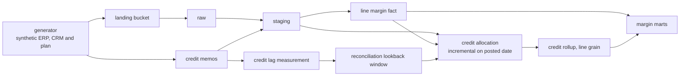

# gross-margin-bigquery

True gross margin by vendor, partner and product line, for a distributor whose
cost is not final when the invoice is. Vendor rebates and price protection credits
arrive weeks after the sale, so a margin number read at month close is wrong until
they land, and this repo is about knowing by how long and by how much.

```
python3 scripts/build_corpus.py
python3 scripts/run_transform.py
python3 scripts/lookback_probe.py
python3 scripts/allocation_fixture.py
```

The first generates the corpus, measures the credit lag and writes
`measurements/credit-lag.json`. The second loads that corpus into DuckDB, builds
the dbt models over it and writes `measurements/transform-shape.json`. The third
measures what a reconciliation lookback would miss under each of the two dates it
could be anchored on. The fourth runs the allocation models over a corpus small
enough to check by hand. Everything the first three write is re-derived by the
check suite, which needs no arguments and no data on disk.

```
python3 tests/run_all.py
```

## Shape



The generator is the only part that runs today. The bucket and the three datasets
are written as Terraform and have not been applied, and no BigQuery statement in
this repository has ever executed.

## The data is generated

Every figure below comes off a generator whose shape was chosen by hand. None of
it is a measurement of a real billing system. The lag distribution is lognormal
per credit kind because a settlement delay cannot go negative and has a long right
tail, and the medians are what the finance teams I have worked with described. That
is a design choice and not a finding.

What is not a design choice is the arrival calendar. Credits post on business days
and nothing posts during the close freeze, so the delay a vendor intends and the
delay a ledger sees are two different quantities. The generator draws the first and
throws the draw away. Only dates reach the output, which means the only lag anybody
can measure here is the one reconciliation will also have to work from.

## What the lag measurement says

The population is 3,591 credit memos over a two year window. 3,588 of those
credits still point at an invoice, and the three that do not are an injected
discrepancy rather than a bug. Rebuild every number here with
`python3 scripts/build_corpus.py`.

| quantity | days |
|---|---|
| observable lag, median | 18 |
| observable lag, ninety fifth centile | 105 |
| observable lag, largest seen | 164 |
| vendor raise lag, median | 17 |
| calendar hold, ninety fifth centile | 4 |

The calendar is worth a line of its own. 308 credits were held three days or more
past the date the vendor raised them, which is longer than a weekend and is the
close batch rather than the clock.

## One lookback window does not work, and it fails in both directions

A reconciliation job reopens a window of past days so that a late credit does not
make a closed period wrong. Sizing that window from the pooled population gives
105 days at a target of ninety five percent coverage. Measured per credit kind, the
same target gives three very different answers.

| credit kind | credits | own window, days | coverage under the pooled 105 day window |
|---|---|---|---|
| price_protection | 1441 | 20 | 100.0 |
| return_credit | 1213 | 49 | 99.84 |
| volume_rebate | 934 | 124 | 82.23 |

Read the last column before the third one. A pooled window advertised at ninety
five percent delivers 82.23 percent on volume rebates, because the pooled centile
is pulled down by the two faster kinds that together hold most of the rows. The
window is simultaneously too short for the kind it was supposed to protect.

In the other direction it is far too long for everything else. Holding every credit
to 105 days when price protection settles in 20 costs 190,413 credit days of
waiting that nothing needs.

A volume rebate cannot be raised until the quarter it belongs to has closed, so its
distance from the invoice depends on where in the quarter the invoice sat. That is
a property of the process and no amount of pooling will make it look like a price
protection claim. The window gets keyed by credit kind.

## Injected discrepancies

The corpus is generated clean and the discrepancies are a separate pass over the
finished rows. A build with nothing requested reproduces the clean corpus byte for
byte, which is what makes it possible to attribute a moved figure to one change.
Each injector reports what it achieved rather than what it was asked for.

| discrepancy | rows | what a pipeline has to notice |
|---|---|---|
| orphan_credit | 9 | a credit quoting a line this system does not hold, and every third one loses its invoice too |
| duplicate_credit | 12 | one vendor document posted twice under two internal ids |
| cents_scaled_amount | 6 | an amount keyed in cents into a column holding dollars |
| overapplied_credit | 14 | a credit worth more than the line it adjusts, which drives cost negative |
| missing_partner | 31 | an invoice with no partner on it, which is the gap between billing and CRM |
| reassigned_product_line | 4 | a product moved to another product line partway through the window |

The last one is the only entry here that is not a bad row. Both product rows are
correct and the dimension is now effective dated, so margin by product line depends
on which row you join to and nothing in the data says that choice was made.

## The transformation layer

The models are written for BigQuery and verified against DuckDB on every run.
Nobody here holds a BigQuery project, so a layer that could only be exercised
against one would ship untested.

17 models and 58 data tests, all passing on
DuckDB. Seven staging views cast the landing text into exact decimals, and the
facts and marts sit above them. The scan pair exists to be queried rather than
read.

Three macros carry everything adapter specific. `money.sql` holds one money cast
and one date cast, because `numeric` is a BigQuery type name with no DuckDB alias
and `date_diff` takes its arguments in a different order on each engine.
`scan_layout.sql` returns a BigQuery partition and clustering spec or nothing,
chosen by adapter. `allocation.sql` holds the quarter truncation, the integer and
text type names, the lookback predicate and one cast described below. A check
refuses any of those spellings written into a model.

| table | rows |
|---|---|
| fct_invoice_line_margin | 20,446 |
| fct_credit_memo | 3,591 |
| fct_credit_allocation | 192,572 |
| credit_rollup_by_line | 20,446 |
| margin_by_vendor | 336 |
| margin_by_partner | 978 |
| margin_by_product_line | 144 |

Invoiced margin over the window is $75,517,103.43 and all
three marts agree with the line grain to the cent. That identity is a test rather
than a note, because three aggregations of one table are three chances to lose a
row.

Three results from building it, and the first is the one worth keeping.

93 invoice lines carry no partner at all, which is
the real gap between a billing system and a CRM. An inner join to the partner
dimension drops every one of them and takes $330,133.19
of margin out of the totals with nothing reporting a loss. They are kept with a
null key and a `has_partner` flag, and the partner mart gives them their own row.

A product can be moved to another product line partway through the window and
both rows are correct, so margin by product line depends on which version you
join to. `dim_product_version` closes each version with the start of the next and
the fact table resolves the one in force on the invoice date.
715 lines sit on a reassigned product.

9 credits name a line this system does not hold and
20 are worth more than the line they
adjust. Both keep their rows and get a flag.

## Credits do not belong to the line they arrive on

A price protection credit adjusts one line and a return credit adjusts one line.
A volume rebate does not. It is earned across a quarter of purchases and it
arrives quoting whichever line the billing system had to attach it to. Read as
one line's cost it makes that line look unprofitable and every other line in the
quarter look better than it was.

`fct_credit_allocation` gives every credit a scope and spreads it over the lines
in that scope, pro rata on the basis the credit adjusts. The scopes degrade in
one direction and nothing falls off the end.

| scope | credits | rows | what it means |
|---|---|---|---|
| direct | 2,650 | 2,650 | a line level credit on a line we hold |
| vendor_quarter | 932 | 189,899 | a rebate spread over the quarter it was earned in |
| invoice | 6 | 20 | the line is unknown and the invoice is not |
| unallocated | 3 | 3 | neither reference resolves |

Shares land on whole cents by largest remainder, with the line id breaking a tie
so the answer does not depend on row order. Every credit's parts sum back to the
credit exactly and a check refuses any that do not. A scope whose basis sums to
zero falls back to an equal split, because a rebate on a quarter of fully
discounted lines still has to go somewhere.

The marts publish three stages of one number. The margin the invoice claims, the
margin after each credit is applied to the line it names, and the margin after
allocation. Allocation moves money between vendors and periods without changing
the total, and it moved something in
294 of the 336
vendor periods. The largest single move is $73,708.33 off one vendor's
quarter, which is 28.0 percent of what that row claimed before
allocation.

The two totals differ by $5,448.99 over the whole
corpus, which is exactly the six credits allocation can place through their
invoice and the named reading cannot place at all. Neither total is the true
margin. The three credits nobody can place are in neither, and they are worth
$27,518.56.

## The lookback is on the arrival date, and that is the whole design

The allocation model is incremental over a window. There are two dates it could
measure that window against and they are not interchangeable.

A credit arrives late. The invoice it adjusts can be eighteen months old. A
window on `invoice_date` therefore reprocesses rows whose answers did not change
and misses the rows whose answers did. A window on `posted_date` reaches a credit
on the day it lands, however old the lines are, and the model replaces whole
credits rather than whole partitions so an old line can be rewritten.

`scripts/lookback_probe.py` measures what the same window length costs under each
reading, over this corpus.

| window | credits an invoice_date window misses | allocation rows it leaves wrong |
|---|---|---|
| 30 days | 1,197 | 177,185 |
| 90 days | 333 | 67,036 |
| 105 days | 168 | 33,413 |
| 180 days | 0 | 0 |

The second column is the one that matters. A missed rebate does not only lose its
own amount. Every line it would have been spread over keeps a share it should not
have, so 168 missed credits leave
33,413 rows wrong.

The same probe reports zero misses for the `posted_date` reading at every window,
and that zero is worth nothing. Arrival order is posting order in this corpus
because the generator writes it that way, so the figure is zero by construction
and says nothing about a real feed. What would make it non zero is a backdated
posting or a replayed load, and neither exists here.

## Proving it on numbers a person can check

Twenty thousand lines cannot be verified by reading them. `scripts/allocation_fixture.py`
builds a six line corpus with the same seven files and the same headers, runs the
real models over it, and compares against figures worked out on paper and written
into the script as literals. It covers all four scopes. There is a rounding tie
that one leftover cent cannot settle evenly and a scope whose basis sums to zero.
One credit has its invoice in one month and its posting in the next.

Then it runs the incremental three times. The second run appends a credit posted
578 days after the invoice it adjusts and asserts that it lands, and the run
refuses to proceed unless that credit's invoice is outside a window of the same
length, so the run is a test of the anchor rather than of the window. The third
appends a credit backdated past the window and asserts it is missed, because a
window that cannot miss anything is not a window.

## Bytes scanned, and why there is no number here

The plan for this layer asked for bytes scanned on three finance queries, with
the clustered table against the unclustered one. **That measurement does not
exist and nothing in this file estimates it.**

BigQuery reports the bytes a query would scan through a dry run, which costs
nothing and needs a billing enabled project. This repository has no credential
path to one. `scripts/scan_probe.py` is the measurement, it names every blocker
and it exits 2 rather than printing anything.

A DuckDB row count is not a substitute. Neither is a file size. They are
different quantities on a different engine and publishing one under the name of
the other is the only way this repository could lie.

What is measurable today is narrower and it is real. `dbt parse` never
opens a connection, so the BigQuery branch of the layout macro resolves with no
credentials. Parsed against the bigquery target, the clustered half comes back
with monthly partitions on `invoice_date` and clustering on `vendor_id` then
`partner_id` then `product_line`. Parsed against duckdb, both halves come back
with neither. The adapter dispatch works. What the layout costs is unknown, and
`dbt compile --target bigquery` cannot help because it opens a connection and
fails to authenticate, with and without `--no-introspect`.

The three queries are executed against DuckDB on every build, once per half of
the pair. They return 3 and
41 and 144 rows and the
two halves agree on all three. That proves the SQL parses and returns something,
which is not the same as measuring it, and the first version of query one failed
exactly there. A macro call inside a line comment renders like any other, the
relation it produced ran to three lines, and two of them escaped the comment.
Compile exited zero on it.

The key order is an argument rather than a result. Clustering prunes on a prefix,
and the first query restricts to one vendor while the second groups by partner
across a month, so vendor first should help query one most and query two least.
Query three reads the whole history and may gain nothing. The probe is what would
settle those three predictions.

## Infrastructure, written and not applied

`infra/` holds a landing bucket, three BigQuery datasets, a build identity and a
billing budget. It has never seen `terraform plan`, because that needs an OIDC
trust between this repository and a billing enabled project and creating that trust
is a one time step by somebody holding owner. The three identifying variables carry
no default, which is stated in `infra/variables.tf` along with what is missing.

`terraform validate` grades the schema and needs no credentials, and it passes. It
will not catch a configuration that is valid and wrong, so `tests/test_infra.py`
grades ten of those as text. A dataset whose contents a destroy may drop. A mart
with a table expiration on it. A bucket in one location and a dataset in another. A
build identity holding `dataOwner` rather than `dataEditor`. An identity pool that
trusts every repository on GitHub. A budget with no threshold above the budget.

## Known limitations

- No BigQuery statement here has run. The models compile for it and are
  verified against DuckDB, so the layer is exercised and the warehouse is not.
- There is no bytes scanned figure, so the clustered and unclustered pair is a
  design with a test harness behind it and no result. `scripts/scan_probe.py`
  names what it waits on.
- DuckDB has neither partitioning nor clustering, so the two halves of the scan
  pair are identical tables there. The check that they hold the same rows is
  real. The layout difference is not, anywhere this has run.
- The analyses are compiled and never executed on BigQuery, so their SQL is
  graded by a parse and by the DuckDB build rather than by the engine the
  partition syntax is for.
- The tail of the lag distribution is a lower bound. 209 credits were scheduled to
  post after the window closes and were not written, so the corpus is right
  censored and the largest lag seen is the largest the window could hold.
- The lag medians are a design choice. They are stated here rather than buried,
  and no claim in this file depends on them being right about any real vendor.
- The windows carry no interval. Each one is a single centile of a single corpus at
  one seed, so the right reading of 20 against 49 is that they differ by a lot and
  not that either is accurate to the day.
- The business calendar holds US federal holidays for the generated window only. A
  wider window needs more rows in that list and nothing fails loudly if it misses.
- The suite builds its own corpus in memory. That is the clean clone case and it is
  not the same as a continuous integration job building from empty, which is the
  durable version and needs a workflow file this repo does not have.
- The allocated margin is a model of where a rebate was earned. It is not a
  recovery of something the data knows and hides. The generator attaches a rebate
  to one line because it has to attach it somewhere, so there is no hidden truth
  to score the spread against, and the fixture grades the arithmetic rather than
  the premise.
- Every vendor in the corpus raises rebates on the same cadence. The generator
  anchors a volume rebate on the quarter end and never reads the vendor's rebate
  program, so the three vendors on an annual program produce quarter anchored
  rebates anyway. Every window figure here is a property of that choice.
- The generator raises one rebate per selected line, so a vendor quarter carries
  several where a real vendor would raise one. The allocation is right about the
  rows it was given and the number of rows is not realistic.
- The rebate basis is extended cost, which assumes a rebate is earned in
  proportion to spend. A tiered rebate is not, and `plans.csv` carries a rate
  column nothing reads yet.
- The zero in the posted date column of the lookback table is zero by
  construction and not a result. Nothing in this corpus is posted out of arrival
  order.
- A line whose product version cannot be resolved has no vendor, so a rebate
  quoting it would fall through to `unallocated` rather than spreading. No line
  in this corpus is in that state, so the path is reasoned about and not
  exercised.
- This file is long. Two of its sections are analysis that belongs in a `docs/`
  page, and moving them also moves tables a check grades in place.
